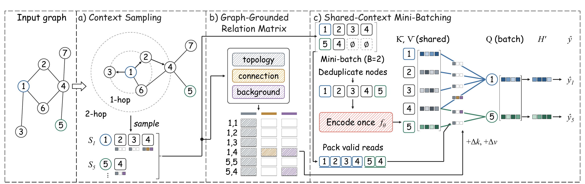

# SCOPE-GT

Code for *Beyond the Token Sequence: Graph-Grounded Evidence and Shared Execution for Tokenized Graph Transformers*.

SCOPE-GT combines bounded context sampling, graph-grounded pair evidence, and shared-context mini-batching for node classification. The repository includes the model, data conversion utilities, and experiment launchers.



## Quick start

```bash
pip install -r requirements.txt
export DATA_BASE=/path/to/datasets
bash scripts/run_main.sh wikics
```

See [data/README.md](data/README.md) for the input file format and conversion commands.
See [docs/reproducibility.md](docs/reproducibility.md) for configurations and experiment protocols.

To run the trainer directly:

```bash
python -m SCOPE_GT.train --preset wikics --data-root "$DATA_BASE/wikics" --device cuda
python -m SCOPE_GT.train --help
```

## Other launchers

```bash
bash scripts/run_ablation.sh wikics
bash scripts/run_budget.sh
bash scripts/run_depth.sh
bash scripts/run_batch_size.sh cost
bash scripts/run_batch_size.sh sharing
bash scripts/run_batch_size.sh collect
bash scripts/run_motivation.sh relation
bash scripts/run_motivation.sh query
pip install -r requirements-experiments.txt
bash scripts/run_mechanism_a.sh
bash scripts/run_mechanism_b.sh
```

Baseline NPZ adapters are bundled in `Baselines/`. See [implementation provenance,
dependencies and commands](docs/baselines.md) for the distinction between upstream,
adapted and paper-guided implementations, including dense Gophormer.

```bash
pip install -r requirements-baselines.txt
python scripts/run_baseline.py gophormer wikics --device cuda:0 --runs 5
bash scripts/run_efficiency.sh
bash scripts/run_transfer.sh
SEEDS="0 1 2 3 4" bash scripts/run_transfer_decompose.sh
bash scripts/run_motivation.sh overlap
```

`SCOPE_GT_BASELINES_ROOT` optionally replaces the bundled adapter tree for the
comparison harnesses. Full training-center traversal is the default on every
classification preset and is required by the efficiency harness.

See [the transfer decomposition guide](docs/transfer-decomposition.md) for the
Table IX FQ/FQ-LG/CQ-U/SCMB mapping, paired seed selection and reporting commands.

## Configuration selection

The original baseline releases do not provide dataset-specific configurations
for most model–dataset combinations in the sixteen-dataset comparison. For
combinations without a matching public configuration, validation-based
hyperparameter search was used to select adapted recipes. The search considered
optimization and regularization settings and, where applicable, method-specific
sampling settings. The selected SCOPE-GT settings are in
[`SCOPE_GT/presets.json`](SCOPE_GT/presets.json).

See [LICENSE](LICENSE) and the retained third-party notices in `Baselines/`.
